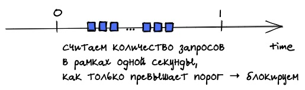
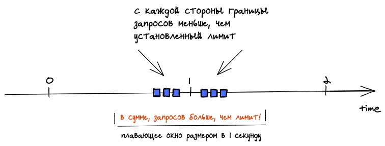
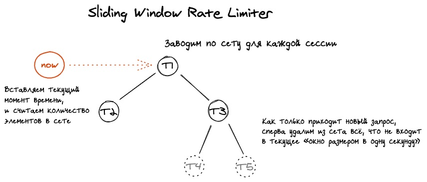
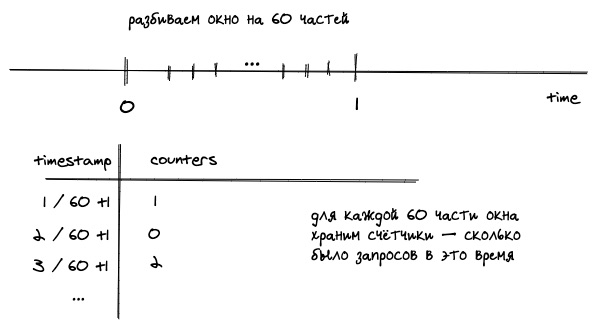

Rate Limiter
============

Aug 31, 2020 · 6 min read

[В прошлой серии](/posts/what-is-system-design.md) было всё в кучу. В этой статье разберём один из популярных вопросов уже конкретнее.

Вы — старший разработчик, архитектор, технический руководитель (нужно подчеркнуть по желанию) в компании, которая делает некое АПИ и продаёт по подписке.

Продукт набирает популярность, пользователей становится всё больше. К вам приходит руководитель продукта со следующей проблемой. Некоторые пользователи делают слишком много запросов. Причём обращаются к URL, которые раздают редко меняющиеся данные.

Руководитель продукта сделал почтовую рассылку, с просьбой прекратить, мол, ну вкрутите вы кеширование на своей стороне, и вообще зачем делать такое огромное количество запросов, там точно в коде всё нормально?

Кто-то даже что-то поправил, но проблема не решена. Во-первых, многие проигнорировали письмо, во-вторых, появляются постоянно новые пользователи, которые разумеется никаких писем не получали.

Как быть?

Вы, как опытный технарь, конечно же сталкивались с такой проблемой и рады поделиться своими знаниями. Есть такая штука **rate limiter** — ограничивает количество запросов в единицу времени. Кажется, это то, что нам нужно!

> Суть этой секции на собеседовании — спроектировать систему как технический эксперт, представляя, что интервьюер это условно младший разработчик или ваш «нетехнический CEO».

Requirements [#](#requirements)
-------------------------------

Итак, какие требования к системе (переводим продуктовую задачу в техническую):

*   Ограничить количество запросов к определённым URL нашей апишки для каждого пользователя, пусть будет 15 запросов в секунду (уже есть система авторизации, каждому пользователю присвоен сессионный токен).
*   Наша система работает на нескольких машинах, поэтому и rate limiter должен быть распределённый.
*   Как только пользователь превышает лимит запросов — отдавать `HTTP 429` (Too Many Requests). У кого-то всё сломается, он вероятно напишет в поддержку, и мы кинем в него ссылку на документацию, где говорится про ограничение на количество запросов в секунду.
*   Rate limiter должен быть максимально доступным и не увеличивать существенно время ответа. Все запросы идут через него и, если он станет бутылочным горлышком, это затронет всех пользователей.

Naive Approach [#](#naive-approach)
-----------------------------------

Первое, что приходит в голову. Заводим счётчики для каждой секунды. Как только в рамках одной секунды запросов становится больше определённого порога — перестаём проксировать запросы приложению, и отдаём `HTTP 429`.

Это будет работать когда нагрузка равномерная: запросов стабильно много и с одинаковой частотой. Однако, в реальной жизни так не бывает. Какие здесь есть проблемы?

На изображении ниже — пример, когда наивный алгоритм не работает.

Возьмём за основу идею **плавающего окна** (sliding window).

Sliding Window [#](#sliding-window)
-----------------------------------

Для каждого юзера (сессионный токен — primary key) будем хранить **Set** таймстемпов моментов времени когда к нам прилетели запросы. Существует сортированный (дерево поиска под капотом) и несортированный (хэш-таблица под капотом) варианты. Нам соответственно нужен тот, который поддерживает сортировку. Зачем?

> Таймстемп — момент времени когда что-то произошло, в любом формате. Зачастую используют формат [unix time](https://en.wikipedia.org/wiki/Unix_time), т.е. количество секунд с 1 января 1970 года.

Таким образом мы сможем поддерживать «плавающее окно» с течением времени. Рассмотрим на примере.

1.  Приходит запрос в момент времени `t`. Удалим из сета всё, что больше `now - 1` — **события, которые случились более 1 секунды назад**. Таким образом наше _окно «плавно движется»_ во времени.
2.  Добавляем в сет текущее время `now`.
3.  Смотрим на количество элементов в сете — если больше 15, отвечаем `HTTP 429`, если меньше 15, проксируем запрос приложению.

Я выбрал именно сортированный `Set` чтобы легко получить минимальный элемент. На первом шаге нужно в цикле удалять минимальный элемент до тех пор пока он не станет больше `now - 1`, после чего все таймстемпы гарантированно укладываются в одну секунду.

> В реальной жизни для такой задачи можно взять Redis, который поддерживает [различные типы данных](https://redis.io/topics/data-types), в том числе и sorted sets.

Back-of-the-napkin math [#](#back-of-the-napkin-math)
-----------------------------------------------------

Сколько нужно памяти, чтобы всё это добро хранить? Давайте прикинем.

Пусть идентификатор пользователя (сессии) занимает 8 байт (размер поля под него). Юниксовый таймстемп 4 байта. Пусть наш лимит 500 запросов в час. Оверхед на сет и саму табличку по 20 байт.

    8 + (20 + 4) * 500 + 20 ~= 12 KB
    

На каждую сессию нужно по 12 килобайт. Чтобы трекать миллион пользователей в любой момент времени потребуется `12 KB * 10e6 ~= 12 GB`.

Многовато будет. Получаем что называется “scalability issue”. Как быть?

Sliding window counters [#](#sliding-window-counters)
-----------------------------------------------------

Можно разделить окно на определённое количество частей и хранить в хеш-табличке счётчики для каждой из них.

Конечно, если окно равно 1 секунде это может быть накладно. Однако, в реальности 15 запросов _в секунду_ — это очень слабый лимит, считай его нет. Например, [Твитер разрешает](https://developer.twitter.com/en/docs/twitter-api/v1/rate-limits/endpoint-rate-limits) **300 запросов за 15 минут** для поиска.

То есть у них окно целых 15 минут, а не одна секунда. Для каждого endpoint можно настроить различные разумные лимиты в зависимости от того, что за там за данные, и это обычно минуты.

Удобно выбрать в качестве окна 1 час и разделить его на 60 частей, тогда каждый счётчик в табличке будет для одной минуты.

Разве это не возвращает нас к проблеме наивного алгоритма?

Мы можем превысить лимит для одной минуты, но не можем существенно превысить лимит для **всего окна** (одного часа). Это кажется **разумным компромиссом** по сравнению с конским потреблением памяти.

> Здесь нет правильных или неправильных решений. Важно оценивать трейд-офы.

Как изменится потребление памяти?

8 байт на айдишник пользователя, 4 байта на таймстемп, 2 байта на счётчик, 20 байт на оверхед хеш-таблиц.

    8 + (4 + 2 + 20) * 60 + 20 ~= 1.6 KB
    

Ещё важное уточнение — записи удаляются через час, т.к. больше смысла держать счётчики нет. Таким образом, для каждого пользователя, нужно хранить 1.6 KB данных в _любой момент времени_.

    1.6 * 10e6 ~= 1.6 GB
    

1.6 GB памяти для миллиона пользователей. Неплохо против 12 GB!

> Кстати, [Redis умеет оптимизировать](https://redis.io/topics/memory-optimization) по памяти хэш-таблички с небольшим количеством элементов (до 100 штук). Что как раз отлично подходит для данной задачи, где записей 60 — для каждой минуты.

Опыт Figma [#](#опыт-figma)
---------------------------

Ребята из Figma [описывают любопытный случай из своего опыта](https://www.figma.com/blog/an-alternative-approach-to-rate-limiting/).

Они вкручивали рейт лимитеры для борьбы со спамом. Так вот отдавая `HTTP 429` они давали спамерам сигнал к тому, что рейт лимитер включился, и те создавали новые фейковые аккаунты автоматически.

В итоге, пришлось отдавать всегда `HTTP 200`, с заранее закешированным фейковым телом ответа, но не пропуская запросы на реальные сервера.

Atomicity [#](#atomicity)
-------------------------

Есть проблема, о которой нужно всегда помнить в мире распределённых систем — race condition, или состояние гонки.

Мы пишем счётчики, потом их же читаем. Легко можно получить два одновременных запроса, один из которых поменяет счётчик, а второй прочитает ещё старое значение.

Страшно ли это? Зависит. Рекомендуется использовать [локи](https://redis.io/topics/distlock) и не забывать, что условно в любой момент времени один и тот же участок кода может выполняться одновременно с двух машин.

Кеширование [#](#кеширование)
-----------------------------

Чтобы хранить миллион пользователей нужно всего 1.6 GB памяти. Можно всё в оперативку запихать — держать кеш. А в базу делать копии раз в какое-то время. Не слишком большое, чтобы было не обидно, если машина отключится и весь кеш потеряется, и не слишком маленькое, чтобы получить профит от меньшей нагрузки на базу.

Особенно кеш очень сильно поможет когда пользователь упрётся в лимиты, и тогда уже не надо ничего писать, а только читать счётчики. На сеть и базу нет нагрузки совсем!

Материалы [#](#материалы)
-------------------------

*   [https://www.figma.com/blog/an-alternative-approach-to-rate-limiting/](https://www.figma.com/blog/an-alternative-approach-to-rate-limiting/)
*   [https://engineering.classdojo.com/blog/2015/02/06/rolling-rate-limiter/](https://engineering.classdojo.com/blog/2015/02/06/rolling-rate-limiter/)
*   [https://www.designgurus.io/course/grokking-the-system-design-interview](https://www.designgurus.io/course/grokking-the-system-design-interview)

PS. Обсудить можно в [телеграм-чате](https://t.me/ctci_chat_ru) любознательных программистов. Welcome! 🤗

Подписывайтесь на [мой твитер](https://twitter.com/vitkarpov) или [канал в телеграме](https://t.me/coding_interviews), чтобы узнавать о новых разборах задач.